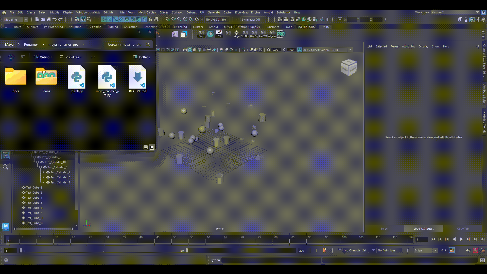

# Maya Renamer Pro

A small Maya tool to rename the selected objects in bulk: add a prefix or a suffix, number them, search and replace text in names, or strip characters.

<p align="center">
  
</p>

## Features

- Add a prefix or a suffix
- Progressive numbering (custom start, padding and separator)
- Search and replace, with optional case sensitivity
- Strip characters from the start, the end, or a range
- Safe with hierarchies: parents and children can be renamed together
- One Ctrl+Z undoes a whole operation

## Requirements

Autodesk Maya 2025 or later (the UI uses PySide6).

## Installation

**Drag and drop (recommended)**

1. Download or clone this repository.
2. Drag `install.py` into a Maya viewport.
3. A **Renamer** button appears in the active shelf.

**Manual**

Copy `maya_renamer_pro.py` into your Maya `scripts` folder, then run in the Script Editor (Python tab):

```python
import maya_renamer_pro
maya_renamer_pro.show_renamer()
```

## Note about selection

If you use the *click and drag* method inside the Outliner, Maya returns the selection in its visual order (top to bottom). To use your custom selection order, select objects with *Shift + Click* or one by one.

## How the code is organized

1. **Logic functions** (`rename_safe`, `add_prefix`, ...): they only deal with names and know nothing about the UI.
2. **The UI class** (`MayaRenamerUI`): it reads the values from the widgets and calls the logic functions.
3. **The launcher** (`show_renamer`): it opens the window.

## AI use disclosure

I coded this tool as a way to learn Python. I used to do C/C++ and HTML in high school, but because some years have passed I used AI assistants to help me *learn*. I didn't want to 'vibe code': I used them to suggest Maya commands, explain logic and functions, and review the code I wrote when I had doubts. I wrote the core logic and learned. The UI started from AI-generated code that I then reviewed until I understood it.

There are surely many ways to write this script better, cleaner or faster, but I had to start somewhere. Looking forward to hearing your feedback, happy renaming!

---

*Made by [@thepainteye_cg](https://www.artstation.com/thepainteye_cg) | GitHub: [thepainteyecg](https://github.com/thepainteyecg)*